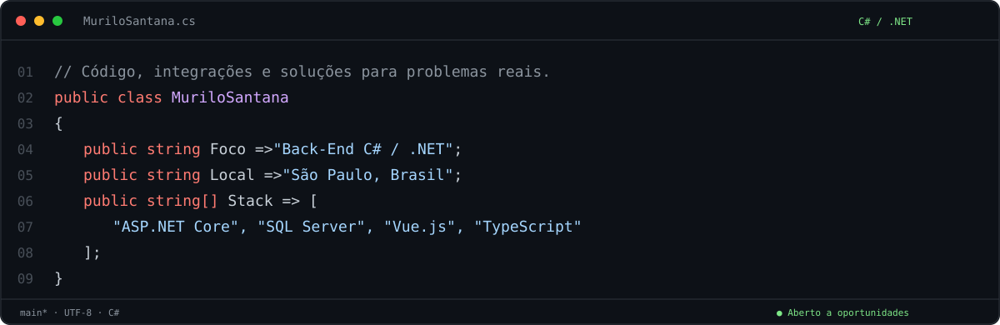

  
  

## Olá, eu sou o Murilo 👋

Sou desenvolvedor com foco em **Back-End C#/.NET**, com experiência em APIs REST, regras de negócio, integrações entre sistemas e SQL Server. Também trabalho com **Vue.js e TypeScript** no desenvolvimento de interfaces integradas a APIs.

Atuei na **WebSupply, de agosto de 2023 a fevereiro de 2026**, passando de estágio a desenvolvedor júnior. Nesse período, trabalhei com aplicações .NET Core, consultas e procedures em SQL Server e funcionalidades de CRM e auditoria de leads, incluindo autenticação, tarefas e integração com Jira.

**Busco oportunidades como Desenvolvedor Back-End .NET Júnior ou Full Stack .NET + Vue.js.**

## Tecnologias

| Área | Tecnologias e práticas |
| --- | --- |
| **Back-end** | C#, .NET 8, ASP.NET Core, MVC, APIs REST, Entity Framework Core, LINQ |
| **Dados** | SQL Server, consultas SQL, procedures, SQLite |
| **Front-end** | Vue.js, TypeScript, JavaScript, HTML, CSS, Tailwind CSS, PrimeVue, Bootstrap |
| **Desenvolvimento** | Git, GitHub, aplicações em camadas, separação de responsabilidades, Scrum |

Nos meus projetos, aplico organização em camadas e continuo aprofundando meus conhecimentos em **Clean Architecture, SOLID e DDD**.

## Projetos em destaque

### Saúde360 · Informação de saúde mais acessível

Aplicação para localizar **UBS e UPAs**, consultar endereços e abrir rotas no Google Maps ou Waze. Permite buscar unidades por localização e explorar os resultados em lista ou mapa.

- **Desenvolvimento:** interface responsiva, geolocalização, mapas e integração com dados públicos.
- **Tecnologias:** Vue 3, TypeScript, Vite, PrimeVue e Leaflet.
- **Objetivo:** facilitar o acesso a informações sobre unidades de saúde.

[**Acessar aplicação ↗**](https://saude360-sp.vercel.app) · [**Explorar código ↗**](https://github.com/Murilovsgama/Saude360)

### Radar de Promoções · Automação e integrações

Projeto de processamento de ofertas, conversão de links de afiliado, geração de imagens e integração com WhatsApp e Instagram.

- **Desenvolvimento:** processamento em segundo plano, persistência de dados e integração entre serviços.
- **Arquitetura:** Worker Service com camadas Domain, Application e Infrastructure.
- **Tecnologias:** C#, .NET 8, Entity Framework Core, SQLite, Node.js e SkiaSharp.

O código deste projeto é privado.

[**Conhecer o Radar no Instagram ↗**](https://www.instagram.com/radar_dpromo/)

## Vamos conversar?

Tenho interesse em trabalhar com **APIs, integrações e aplicações .NET**, contribuindo com minha experiência e aprendendo com o time.

[**Entre em contato pelo LinkedIn ↗**](https://www.linkedin.com/in/murilo-vitor-dev/)

---

São Paulo, Brasil · C# / .NET / Vue.js
